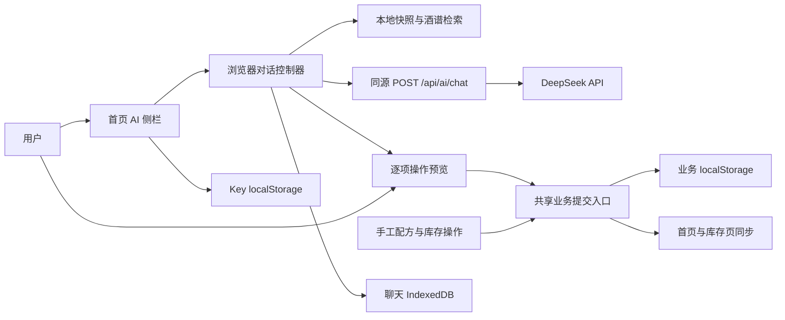

# DeepSeek 调酒助手技术设计

本设计基于 DeepSeek 调酒助手 PRD v3，采用同源服务端转发、浏览器端工具编排和本地确认提交。服务端只负责模型通信；库存、自定义配方、聊天记录和操作执行留在浏览器。所有手工修改与 AI 修改使用同一业务写入入口，以保证变更预览、重复提交保护和页面同步一致。

| 项目 | 内容 |
| --- | --- |
| 设计版本 | v1，2026-10-13 |
| 需求基线 | [PRD v3](./prd.md)，权威内容为 [state.json](./state.json) |
| 基线状态 | draft；AC-001～AC-007 已确认，AC-008 性能验收待实测 |
| 基线内容 SHA-256 | `81681d8ec39754bd47db8eba2f9a2f1718a6c4ec9ac7e20117bcd1e415e977c1` |
| 设计范围 | 架构、模块、协议、工具、持久化、确认执行、异常与验证方案 |
| 技术方案性质 | 本文提出的接口与模块尚待实现；不改变 PRD 审批状态 |
| 数据范围 | 原料有无、文字配方和内置酒谱；无库存余量、删除操作、图片识别或跨设备同步 |

## 现有系统与设计约束

| 现有代码 | 当前行为 | 设计影响 |
| --- | --- | --- |
| `app/page.tsx` | 首页持有库存、配方与收藏状态，通过 effect 自动保存；监听同页自定义变更事件 | 引入共享状态访问和命令式提交，避免过期整份状态回写 |
| `lib/ingredient-storage.ts` | `blendingpidia-v1` 保存业务数据；当前库存版本为 3；读写有失败路径 | 保留业务键及迁移行为，扩展可选操作回执 |
| `lib/ingredient-registry.ts` | 原料具有 ID、双语名称、类别、别名及归档/删除状态 | 模型读取名称，操作执行以 ID 定位；歧义名称不得自动选第一个 |
| `lib/cocktail-index.ts` | 计算原料缺失及 broken 状态；mixer、garnish 为可选类别，已删除引用仍计为缺失 | 可制作状态由应用计算，模型只解释结果 |
| `lib/custom-recipes.ts` | 配料规范化、同名检查、编辑保留 ID 和 likes | 复用纯函数，补上写入边界的严格验证 |
| `app/stock/page.tsx` | 原料新增、编辑、归档、恢复和删除等手工操作 | 本次 AI 只开放新增、切换有无和归档；共享提交机制覆盖已有手工写入 |
| `hooks/use-cocktail-details.ts` 与详情 API | 内置酒谱的用量和步骤按 ID 读取 | 提取可复用详情加载函数，AI 回答具体配方时读取详情 |
| `vite.config.ts` | vinext、Cloudflare 和现有 Sites 构建配置 | 使用 Web 标准 fetch 和流式响应；不要求新增 D1、R2 或用户数据库 |

首页现有表单在修改 React 状态后提示结果，持久化稍后才由 effect 完成。新设计必须将“提交成功”定义为业务存储写入成功，不能沿用先提示保存成功的时序。首页、库存页、收藏及载入时的迁移写入都要经过共享入口；仅给 AI 增加锁不能阻止其他写入者覆盖数据。

## 架构与职责



| 模块 | 责任 | 边界 |
| --- | --- | --- |
| AI 侧栏 | 消息、流式文本、来源卡片、操作差异、确认/取消、配置和清空入口 | 不直接写业务存储 |
| 对话控制器 | 维护轮次、读取快照、调模型、执行只读工具、创建操作预览、停止与恢复 | 不绕过操作校验和确认 |
| 上下文服务 | 解析库存 ID、搜索酒谱、取得详情、提供来源及缺料事实 | 不向模型发送图片、Key 或业务恢复备份 |
| 工具分派器 | 严格解析工具参数，区分只读与提议工具 | 未在白名单的动作一律拒绝 |
| 操作服务 | 规范化提议、生成差异、检查前置条件、提交和幂等判断 | 只接受当前会话有效的显式确认 |
| 业务仓储 | 在锁内读取最新状态、应用命令、持久化、通知页面 | 手工操作和 AI 操作共用 |
| DeepSeek 网关 | 验证协议、构建系统提示、固定上游、转发一轮模型请求、标准化事件 | 不保存 Key、聊天或执行业务工具 |
| 聊天存储 | 保存消息和展示所需来源、操作结果，恢复为不可自动执行的历史 | 与业务数据和 Key 分开管理 |

服务端转发优于浏览器直连的原因是应用可以统一控制上游地址、工具定义、输入限制和错误输出，不依赖浏览器跨域配置。用户的 Key 仍会在请求中经过应用服务端，仅用于当次上游认证，不写入服务端存储。部署需使用 HTTPS，并明确关闭此路由的请求头、请求体及响应正文日志。

首版使用原生 fetch，不增加代理框架或数据库。模型适配封装为 `DeepSeekClient`；初始技术选择为 `deepseek-flash`、关闭 thinking、开启 stream，模型 ID 在网关配置中维护，不接受浏览器传入任意模型或上游 URL。正式接入前再次核对账户可用模型。官方 API 提供这些请求字段和 SSE 响应格式。[Chat Completions API](https://api-docs.deepseek.com/api/create-chat-completion/)

## 建议文件组织

下表路径均为项目相对路径，是计划接口，不表示文件已存在。

| 路径 | 主要内容 |
| --- | --- |
| `components/ai/assistant-sidebar.tsx` | 侧栏布局、输入框、聊天与操作预览 |
| `components/ai/api-key-settings.tsx` | 遮蔽 Key 输入、保存、清除与错误反馈 |
| `components/ai/operation-preview.tsx` | 单项 before/after、影响和确认状态 |
| `hooks/use-ai-assistant.ts` | 对话状态机、流解析、取消与轮次编排 |
| `hooks/use-app-storage.ts` | 页面共享业务状态订阅，含跨标签同步 |
| `lib/ai/contracts.ts` | 请求、事件、工具、提议与错误类型 |
| `lib/ai/context.ts` | 本地快照、来源范围与检索结果投影 |
| `lib/ai/tools.ts` | 工具 schema 与参数校验的共享定义 |
| `lib/ai/tool-dispatcher.ts` | 浏览器只读工具与提议工具分派 |
| `lib/ai/operations.ts` | 提议规范化、差异、前置条件和执行命令 |
| `lib/ai/chat-storage.ts` | IndexedDB 历史、恢复和清空 |
| `lib/ai/key-storage.ts` | 单独的 Key localStorage 访问 |
| `lib/ai/deepseek-client.ts` | 仅服务端导入，上游请求与流适配 |
| `lib/ai/server-policy.ts` | 系统提示、模型与工具白名单、输入限制 |
| `lib/app-storage-repository.ts` | 锁、最新状态读取、共享提交和订阅 |
| `lib/cocktail-details.ts` | 从现有详情 hook 提取的加载及缓存函数 |
| `app/api/ai/chat/route.ts` | 单轮模型转发接口 |

既有 `ingredient-storage.ts` 保留低层读写、业务迁移与恢复处理；仓储在其外层提供提交契约。表单校验中的通用原料和配方规则提取成纯函数，由手工表单和 AI 同时使用。TypeScript 类型不代替运行时校验；首版采用显式校验函数，不为此单独增加 schema 库。

## 对话与请求协议

### 浏览器发起一轮模型请求

新接口为 `POST /api/ai/chat`。每次请求只处理一次上游 completion，工具循环由浏览器控制器驱动；服务端不建立有状态会话。

请求使用 `Content-Type: application/json` 和 `Authorization: Bearer <用户 Key>`。Key 仅在认证头中传递，不能放进 JSON、URL、工具参数或模型 messages。

```ts
type ChatRequest = {
  schemaVersion: 1;
  requestId: string;
  turnId: string;
  lang: 'zh' | 'en';
  snapshot: {
    version: string;             // 当前规范化业务状态的指纹
    capturedAt: string;
    stock: StockFact[];          // ID、名称、有效状态；无数量字段
    customRecipeCount: number;
    builtInRecipeCount: number;
    migrationIssueCount: number;
    coverage: ContextCoverage;
  };
  messages: ProviderMessage[];   // 当前消息及完整保留的历史轮次
};
```

`ProviderMessage` 只允许 user、assistant、tool 角色。服务端生成 system 消息、工具白名单和模型参数，不接收客户端自定义 system、tools、baseUrl 或认证字段。验证 assistant 的 tool_calls 与后续 tool_call_id 成对；请求超限在调用上游前失败。

库存名称、配方步骤和聊天文本都是数据，不具有系统指令权力。系统提示要求使用只读工具查事实，写入只产生提议，并区分 `pending_confirmation` 与 `committed`。实际权限始终由应用校验，不能依赖提示词阻止误操作。

### 应用流式事件

服务端把上游 SSE 转换为应用 SSE。事件 data 为 JSON；这是应用自定义协议，与 DeepSeek 原始字段分离。

| 事件 | 数据要点 | 浏览器处理 |
| --- | --- | --- |
| `start` | requestId、turnId、snapshotVersion | 建立流所属轮次 |
| `text_delta` | 增量文字 | 追加草稿文本 |
| `tool_calls` | 完整工具名、callId、完整参数字符串 | 仅在完整、正常结束的工具响应后分派 |
| `usage` | 上游实际返回的使用量 | 展示或保存在本地；缺失则标未知 |
| `done` | finishReason | 正常完成一次模型轮次 |
| `error` | code、retryable、requestId | 停止解析并显示规范化错误 |

工具参数按 call index/ID 聚合增量，支持 JSON 被拆到多个网络块、多个 SSE 帧以及一次多工具调用。缺少正常终止、JSON 不完整、`finish_reason=length` 或流中断时不创建可执行提议，也不把截断文本标成完整回复。

浏览器使用带 AbortSignal 的 fetch 读取 SSE，不采用 EventSource，因为请求需要 POST 和认证头。请求取消时网关应同时取消上游 fetch 和释放流；网关实现只能使用当前运行时支持的 Web API。基础 SSE 能力来自官方接口；应用事件、状态和错误码由本设计定义。[Chat Completions API](https://api-docs.deepseek.com/api/create-chat-completion/)

### 工具循环

1. 从最新业务存储加载状态，生成固定的本轮快照；存储读取失败时阻止发送，不以默认库存替代失败数据。
2. 发送用户消息、完整历史轮次和本轮库存事实。
3. 收到完整工具调用后执行只读查询，或生成待确认提议。每个 tool_call 都返回对应的工具结果，包括失败或 `pending_confirmation`，保证协议完整。
4. 将 assistant tool_calls 和对应 tool 结果追加后续请求，让模型解释结果。工具轮次数、输出规模与上下文预算达到上限时明确停止。
5. 对话可以结束在“请确认这些修改”。点击确认只触发本地提交；本地结果直接显示，下次提问附带由真实业务回执及本地取消状态生成的操作摘要，不使用模型自述作为执行结果，不自动多发一次收费模型请求。
6. 新用户消息重新读取最新快照。旧库存快照和旧工具事实不作为当前业务事实重新注入。

同一侧栏一次只有一个生成轮次。生成中业务数据改变时取消当前轮次，标记数据已更新，并使基于旧状态的待确认提议失效；用户可以重试。已确认操作的结果按真实回执展示，不因取消后续生成而回滚。

聊天历史可以保留，但送给模型的是预算内最近的完整轮次，不能从中间拆开工具调用链。旧快照与旧检索结果移除或替换为明确标注的历史摘要。侧栏展示“使用最近对话”的范围；用户问未载入的更早记录时提示限制，不声称已完整阅读。

## 数据上下文和酒谱检索

`LocalSnapshot` 在浏览器保有完整规范化库存、原料注册表、自定义配方和内置索引。发给模型的快照先包含当前有效库存与集合数量；具体配方通过工具检索，避免每次发送整个内置库。

| 工具 | 输入 | 返回 |
| --- | --- | --- |
| `list_stock` | 无 | 本轮有效原料 ID、双语名称、类别，以及未解决迁移项数量 |
| `search_recipes` | query、scope、availability、cursor | 当前索引中的匹配摘要、来源、缺料、broken、total、nextCursor |
| `read_recipe` | recipeId | 配方文字字段、来源、详情状态和基于本轮库存的可制作事实 |

scope 为 `all/custom/builtIn`。搜索先对完整本地集合进行已有索引匹配和过滤，再分页返回；空 query 可以列举集合。结果含稳定 cursor 及覆盖范围，游标绑定 snapshotVersion，不能在数据更新后继续旧分页。不需要首版向量数据库。

库存读取要过滤归档、删除和不可追踪项目；未解决迁移项只表示库存尚不完整，不能自动计入已有原料。原料名称解析使用注册表；若多个记录匹配同一名称，返回候选 ID 供选择。

`read_recipe` 对自定义配方直接读取文字字段；对内置配方结合摘要与 `/api/cocktails/[id]` 详情。详情读取失败时返回 `detailsStatus=unavailable`，可提供已取得的摘要，但不能编造来源用量和步骤。图片 URL、图片文件、likes、恢复备份均不送给模型。关联配方使用 parentId，需要时再读父配方。

每份工具结果带 `snapshotVersion`、`source`、`recipeId`、`detailsStatus` 和 `coverage`。可制作状态直接调用 `buildCocktailIndex` 与 `calculateAvailability`；可选项、已删除引用和缺料解释沿用应用规则。

回答中的已收录配方使用 `recipe:<id>` 标记，前端只为已读取且有效的 ID 显示来源卡片，并以应用计算结果展示缺料和可制作状态。未知 ID 不渲染来源。AI 创作和替代方案单独标识，不能把改写后的内容绑定成原始酒谱事实；自然语言的忠实性仍需场景验收。

`ContextCoverage` 明确区分库存是否完整、配方集合总数、本轮已读取配方 ID 和分页/历史是否截断。上下文装不下完整库存时直接返回超限错误；配方按需读取时明确“已读取相关酒谱”，不称已读完整酒单。

## 操作提议与逐项预览

模型只可以调用以下五种提议工具。工具返回预览对象，不写业务数据。

| 提议工具 | 可修改内容 | 关键验证 |
| --- | --- | --- |
| `propose_create_recipe` | 新自定义配方文字字段、可选 parentId | 名称、至少一项配料、方法枚举、用量对齐、父配方存在、同名提示 |
| `propose_update_recipe` | 指定自定义配方的文字字段 | 目标存在且 isCustom；保留 ID、likes、图片和未声明字段 |
| `propose_set_stock` | ingredientId 对应的有/无状态 | 使用绝对值 present，不使用 toggle；原料有效且可追踪 |
| `propose_create_ingredient` | 中英文名与类别 | 两个名称非空、类别合法、名称/别名碰撞检查，包括删除名称保留规则 |
| `propose_archive_ingredient` | 指定原料归档，并退出库存 | 目标有效；预览列出库存变化和引用配方影响 |

模型不能设置原料的 deleted、custom、ID，或配方的 likes、isCustom、图片。不提供删除、恢复、直接修改内置配方或修改原料名称的 AI 工具。新增原料不自动标记为已有；需要加入库存时产生另一个独立提议。新增配方也不自动创建未知原料，使用现有配料规范化规则，并标明尚不在库存的配料。

规范化先于预览：配方 ingredient rows 转为现有 ingredients/measures，清理空值并合并重复原料；用户看到的是实际准备保存的值。同名配方沿用现有“提示后仍可明确保存”的规则，预览突出显示重名，确认按钮明确该含义；原料重名则阻止提交。不接受无法解析、未声明或超过长度限制的字段。

```ts
type OperationProposal = {
  proposalId: string;            // 应用生成，不使用模型提供的 ID
  operationId: string;           // 整个提议生命周期不变
  sessionId: string;             // 当前打开侧栏的执行会话
  turnId: string;
  kind: OperationKind;
  targetId?: string;
  payload: NormalizedPayload;
  before: PreviewValue;
  after: PreviewValue;
  impacts: OperationImpact[];
  preconditions: {
    targetFingerprint?: string;
    dependencyFingerprints: Record<string, string>;
    desiredStateFingerprint: string;
  };
  status: ProposalStatus;
};
```

新建 ID 在应用创建提议时生成并保存到不可编辑的规范化 payload；配方使用 UUID 风格的稳定字符串，原料复用 `createCustomIngredientId`。既有配方 ID 不迁移，更新保留原值。预览后再编辑 payload 必须产生新预览与新确认；模型输入和聊天文本不能提供“已确认”标志。

每个提议是独立操作。请求涉及多个对象时按顺序展示卡片，每张卡片有独立确认、取消和结果。若后一项依赖前一项新增的原料，前一项成功后才能生成或刷新后一项预览，不把“确认第一项”扩展为授权第二项。

## 提交一致性和幂等

### 共享提交入口

建议契约为 `repository.commit(command, expectedPreconditions)`，内部完成：

1. 获取同源业务写锁。
2. 重新 `loadAppStorage`，保留原始未知字段和恢复信息；重新构建注册表。
3. 检查 operationId 回执、目标存在性、关联依赖和预览前置指纹。
4. 校验并应用单项命令，调用已有规范化/迁移协调纯函数，重新计算最终差异。
5. 最终结果必须与已展示预览一致；出现额外业务影响时返回 stale，重新预览。
6. 将业务变化与成功回执写入同一个业务 JSON，一次 `localStorage.setItem` 完成。
7. 写入返回成功后发布状态、更新卡片和通知同页/其他标签页；释放锁。

写锁选用 `navigator.locks.request('blendingpidia:app-storage')`，同一 origin 的手工和 AI 写入必须遵守相同锁。Web Locks 支持同源标签页协调，且依赖安全上下文；不能约束旧版本页面或绕过仓储的写入代码。[Web Locks API](https://developer.mozilla.org/en-US/docs/Web/API/Web_Locks_API)

无 Web Locks 的浏览器降级为 AI 只读，显示无法保证并发提交；手工功能可以保留原行为。启用 AI 写入前需完成所有写入者迁移。部署切换期间要求已打开的旧版本页面刷新，混用旧写入者不属于此方案保证范围。

首页不再通过整份 React 状态的变化自动回写业务数据，表单和收藏操作提交具体命令；载入迁移也由仓储显式提交。React 状态只订阅已持久化的最新结果。库存页的 persistInventory 改为同一命令入口。事件回调不能再次写入，避免同步循环。

### 前置条件和冲突

提议前置条件覆盖目标、所用原料、父配方和影响预览所依赖的记录。配方编辑指纹包含整个目标记录，避免覆盖确认前的图片或手工修改；原料归档还校验相关配方引用集合及其库存状态。并发的新名字占用在提交时再次检查。

指纹使用稳定字段顺序的规范化 JSON 和浏览器 SHA-256 计算，用于变化检测，不作为权限签名。仅收藏或无关配方改变时可以在最新状态上合并目标命令；目标或依赖改变时要求重新预览、重新确认。整个读取、校验与保存过程在锁内，模型请求和用户等待不持锁。

### 操作回执

业务 JSON 新增可选 `aiOperationReceipts`，不改变库存版本 3 的语义：

```ts
type OperationReceipt = {
  operationId: string;
  payloadHash: string;
  kind: OperationKind;
  targetId: string;
  committedAt: string;
  resultingFingerprint: string;
};
```

回执包含操作元数据，不保存 Key、聊天或完整配方副本。payloadHash 由规范化 kind、targetId 和 payload 生成，不包含易变的展示状态。读取旧数据时缺失字段视为空；扩展 AppStorageState 的可选回执字段，并让低层加载、迁移和手工保存保留该字段。业务仓储通过扩展低层保存参数，把变更和回执放到同一存储键中提交；不能先保存业务，再单独保存成功标记。

同一 operationId 和 payloadHash 已有回执时返回原成功结果，不重复新增或再次切换库存；相同 ID 对应不同 payload 时返回冲突。按钮提交中锁定，回执提供刷新/崩溃后的恢复依据。重试失败操作复用原 operationId，不能重新生成 ID。

如果业务已写入、聊天结果写入失败，业务回执仍是事实来源；界面提示“业务已保存，聊天记录未保存”，不能重做业务操作。回执保留，不因清空聊天删除；未来压缩必须同时保证旧提议不能重放，首版达到容量限制时拒绝新写入，不静默删除幂等记录。

## 本地持久化与恢复

| 数据 | 建议位置 | 清除或恢复规则 |
| --- | --- | --- |
| 库存、原料、自定义配方、收藏、迁移信息、操作回执 | 原有 `blendingpidia-v1` localStorage | 沿用原业务读取/迁移，聊天清空与 Key 清除均不影响 |
| 用户 Key | `blendingpidia-ai-key-v1` localStorage | 独立 schema；默认遮蔽；清除只影响 AI 认证 |
| 聊天消息、来源和提议展示快照 | `blendingpidia-ai-v1` IndexedDB | 保存完整历史，单独清空；记录不包含 Key |
| 生成中的请求、AbortController、确认能力 | 当前页面内存 | 重载后不恢复执行能力 |
| 搜索索引与内置详情缓存 | 当前页面内存 | 按现有数据重新生成 |

聊天采用 IndexedDB，以减少大量历史占用业务 localStorage 和同步写入造成的卡顿。无新增运行依赖；提供小型原生存储封装。数据库打开、升级或写入失败需提示；可以继续本次会话，但不能声称历史已保存，也不自动退回业务存储键。

恢复时历史消息可以继续用于对话。历史中 pending 提议显示为“历史提议，需重新生成”，即使原状态为 awaiting_confirmation 也不启用确认按钮。已提交提议通过回执展示结果，正在保存但无回执的提议显示“未确认保存成功”。新会话 sessionId 与旧记录隔离，聊天加载器不调用业务执行器。

清空聊天先取消正在生成的请求、递增会话 epoch、失效待确认提议，再清理聊天库；迟到的网络块和异步保存任务按 epoch 丢弃，避免重新写回已清空记录。清除 Key 同时取消当前请求并从内存移除认证信息；聊天和酒单保留。正在提交的本地业务操作完成后按真实结果显示，不撤销已经写入的数据。

监听原有同页事件和浏览器 `storage` 事件同步业务。清除 Key 或聊天还需广播给同源标签页，更新各自内存与 epoch；聊天消息追加采用消息 ID 和 IndexedDB 事务合并，避免多标签最后写入覆盖其他记录。

## 界面状态与异常

对话状态为 `idle → preparing → streaming → resolving_tools → streaming → completed`，可以进入 cancelled 或 failed。操作提议状态为 `awaiting_confirmation → committing → committed`，或 cancelled、stale、failed。UI 每次展示的“已保存”只来自业务回执。

| 场景 | 行为 |
| --- | --- |
| 未填写或 Key 保存失败 | 提示配置/保存结果；不调用模型；保存失败时不得显示已永久保存 |
| Key 无效或余额问题 | 显示认证/账户状态提示，不回显 Key 或上游原始请求 |
| 断网、限流、上游服务失败 | 保留用户输入和已取得文本，标注失败，可手动重试 |
| 用户停止生成 | Abort 请求，忽略迟到事件，未完整工具调用不产生提议；当前轮次未确认提议失效，已提交业务结果保留 |
| 本地业务读取失败 | 阻止提问和写入，保留原始数据，不替换为空库存 |
| 配方详情读取失败 | 返回可用摘要和详情不可用状态，不编造步骤或用量 |
| 工具参数非法、工具不支持 | 返回受控工具错误，零业务写入；循环次数达到上限停止 |
| 确认前目标改变 | 提议标 stale，展示最新数据，要求重新预览和确认 |
| localStorage 配额或写入失败 | 不发布成功状态，不增加成功回执；保留提议供用户重试 |
| 上下文、历史或工具结果超限 | 展示实际读取范围；不能静默丢字段后声称全部已读 |
| 返回包含删除或图片修改意图 | 无对应工具；非法 payload 直接拒绝 |

接口错误 JSON 使用 `{error:{code,retryable},requestId}`。应用码包括 KEY_REQUIRED、KEY_INVALID、ACCOUNT_UNAVAILABLE、UPSTREAM_RATE_LIMITED、UPSTREAM_UNAVAILABLE、CONTEXT_LIMIT、INVALID_PROTOCOL 和 REQUEST_ABORTED；本地另有 STORAGE_UNAVAILABLE、STORAGE_INVALID、STALE_PROPOSAL、INVALID_OPERATION。实施时按官方错误响应核实映射，不直接展示未经清理的上游 body。

首版无后台自动重试。用户手动重试模型回复不触发业务写入；工具执行和确认仍使用 operationId。生成限时、空闲超时、上下文预算、工具轮次数和字段长度均在集中配置中管理，具体值待运行环境与实测确定，并在实施时提供有限默认值；不能无限工具循环或无限输出。

## 网关和数据边界

网关只请求固定 DeepSeek HTTPS 地址，拒绝客户端 URL，默认不跟随跨地址重定向。请求要求同源 Origin、JSON 内容类型及适用的 fetch metadata 检查，不开放跨域调用；这是接口使用边界，不是账号认证系统。

在路由和适配器中不记录 Authorization、messages、工具参数、上游响应正文或完整 Error 对象。诊断只允许 requestId、错误码、阶段时长与不含内容的规模统计；上游异常转成清理后的错误。部署平台的日志/APM 必须同样排除敏感请求数据。网关响应设置 no-store，不使用公共缓存。

模型请求使用文字内容白名单投影；配方步骤中的指令也只是资料。工具结果与操作状态由应用生成，模型不能把聊天中的“已确认”转成用户授权。答案以文本或禁用原始 HTML 的 Markdown 展示，来源跳转只接受已验证的本地 recipe ID，不执行模型提供的链接或代码。

浏览器保存 Key 遵循用户已选方案；界面遮蔽不提供加密保护，同源脚本仍可访问。Key 访问模块只向请求认证流程提供值；消息存储和导出诊断不得接触 Key。用户调用时，选取的库存和配方文字会经网关发送至 DeepSeek，应用服务端不保留这些内容。

## 验证与需求追溯

下列为实施后的验证计划，本次文档交付未执行接口、业务或性能测试。

| PRD | 设计覆盖 | 关键验证 |
| --- | --- | --- |
| REQ-001 / AC-001 | 侧栏、IndexedDB、历史恢复、epoch 清空 | 连续追问、刷新恢复、清空时流仍到达、多标签清空 |
| REQ-002 / AC-002 | 独立 Key 存储、请求头、脱敏网关 | Key 恢复/清除；请求 JSON、聊天库、URL、日志无 Key |
| REQ-003 / AC-003 | 最新快照、注册表、搜索和 read_recipe | 双语/自定义原料、归档、空库存、坏数据与迁移未解决项 |
| REQ-004 / AC-004 | 缺料计算、详情读取、来源卡片和创作标识 | 内置摘要不等于详情；未知来源、缺失步骤、替代与创作区分 |
| REQ-005 / AC-005 | 五类提议、规范化预览、逐项确认 | 每种动作确认/取消；多对象只确认一项；归档影响；拒绝删除 |
| REQ-006 / AC-006 | 共享仓储、锁、前置指纹、同键回执 | 双击、重复执行、多标签并发、手工修改冲突、写入失败及崩溃恢复 |
| REQ-007 / AC-007 | SSE 解析、Abort、错误码和预算 | 分片工具 JSON、多个工具、半截流、停止、超时、限流和手动重试 |
| REQ-008 / AC-008 | 阶段测量与参数集中配置 | 实测数据规模、历史规模、模型、环境、并发与时延分布后确认阈值 |

重点验证“业务已写入但聊天失败”“首页旧状态随后保存”“同一原料的新别名造成碰撞”“确认前图片手工变更”和“清空后迟到的工具结果”。这些场景需要可控的存储故障与流响应，而不是逐字匹配生成回答。

适当验证层次为纯函数与命令单元验证、网关流和错误集成验证、浏览器端逐项确认与持久化场景验证。沿用项目现有测试组织和脚本，实施时再选择最小必要浏览器测试工具。构建与 lint 只能验证静态/打包问题，不能代替业务验收。

## 性能和部署待验证项

| 项目 | 测量或确认内容 |
| --- | --- |
| 数据规模 | 内置库、自定义配方、原料、历史轮次数、最长配方文字和迁移信息规模 |
| 运行环境 | 本机 vinext dev 与实际 Cloudflare 部署，浏览器版本及网络条件 |
| 模型条件 | 模型 ID、thinking 关闭、输入输出预算、工具循环次数 |
| 时间指标 | 点击发送至首段文本、完整回复、工具解析、详情查询、确认至持久化 |
| 统计口径 | 重复次数、冷热状态、并发、时延分布和失败率，按实测方案明确 |
| 网关限制 | 上游可达性、流式缓冲、取消传播、平台时限、请求体上限与日志配置 |
| 浏览器能力 | Web Locks、安全上下文、IndexedDB、localStorage 配额和私密模式行为 |
| 技术参数 | 预算、页大小、工具上限、超时和历史裁剪策略，在有限实测值基础上配置 |

性能阈值不在本文擅定；测量结果进入后续 PRD 修订并由用户确认。服务端转发、流式取消和 Web Locks 降级须在实际目标运行环境验证后才能宣布接入可用。用户可以先依据本文审阅功能设计，性能未定不妨碍文档交付，但仍阻止原 PRD 进入完整正式审查。

## 设计选择与兼容性

| 选择 | 理由 | 兼容要求 |
| --- | --- | --- |
| 服务端单轮转发 | 隔离上游协议，统一模型与工具定义，使用现有 API 路由 | 不引入用户服务端存储；Key 只在当次请求内使用 |
| 浏览器工具编排 | 用户数据已在浏览器，本地业务操作易与页面同步 | 工具结果、确认权限和执行状态不能由模型自行决定 |
| 共享命令提交 | 解决当前 effect 整份回写与 AI 写入之间的竞态 | 首页、库存页、收藏和迁移路径必须一起接入 |
| 同键操作回执 | 业务成功和幂等记录保持同一次存储提交 | 原有键、未知字段、收藏和迁移备份保留 |
| 聊天 IndexedDB | 历史较大且不应占用业务同步 JSON | 历史恢复无执行能力；聊天故障不撤销业务成功 |
| 确定性本地检索 | 复用原有索引和可制作规则，首版无需向量设施 | 必须可分页遍历及明确阅读范围 |
| 单项操作确认 | 与用户选择一致，避免整批授权与部分成功混淆 | 依赖项完成后刷新下一项预览 |

可选回执字段读取兼容旧数据；库存版本 3 保持不变。新增配置和聊天存储不触发库存迁移。若退出 AI 功能，保留业务结果；旧聊天不自动再执行操作。旧版本应用可能不遵守新锁和提交规则，因此回退或混用版本时需要重新评估并发保证，不能承诺旧写入者具备本设计的保护。

## 依据

需求以本目录 state.json 的 v3 为准，功能范围、逐项确认和文字边界对应 DEC-001～DEC-012。当前代码证据为 app/page.tsx、app/stock/page.tsx、lib/ingredient-storage.ts、lib/ingredient-registry.ts、lib/custom-recipes.ts、lib/cocktail-index.ts、hooks/use-cocktail-details.ts、app/api/cocktails/[id]/route.ts、tools/cocktail-catalog-plugin.ts 和 vite.config.ts。

DeepSeek 工具调用只返回函数调用，具体工具由应用提供和执行；本设计在应用中增加参数验证与确认提交。[Tool Calls](https://api-docs.deepseek.com/guides/tool_calls/)

